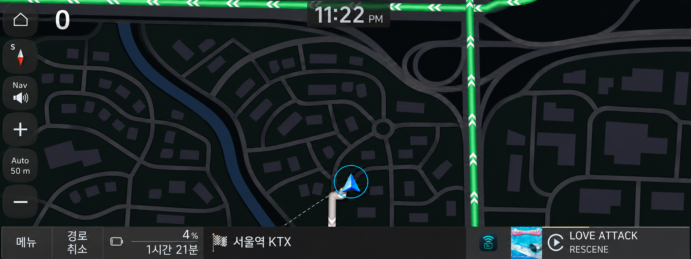
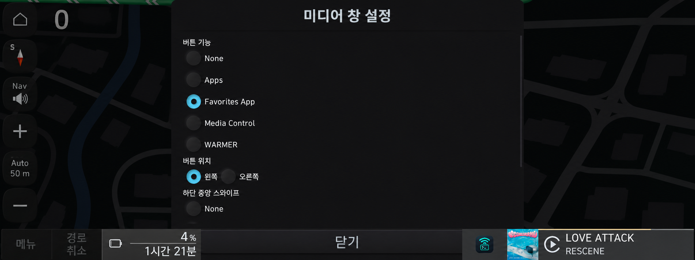
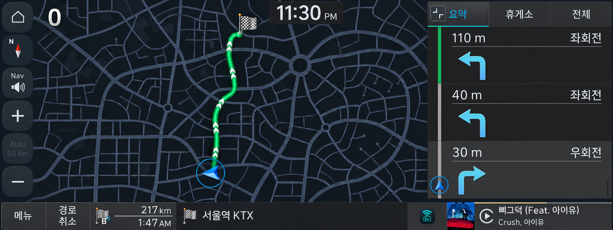
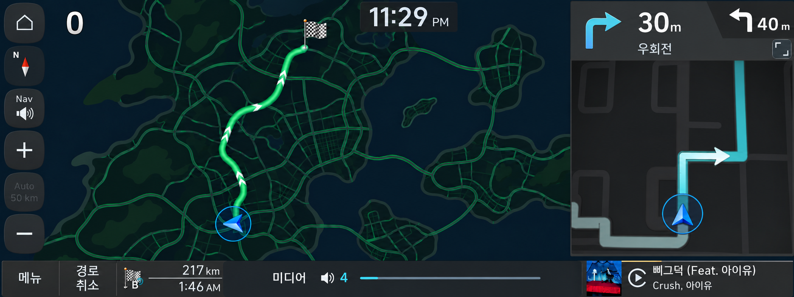
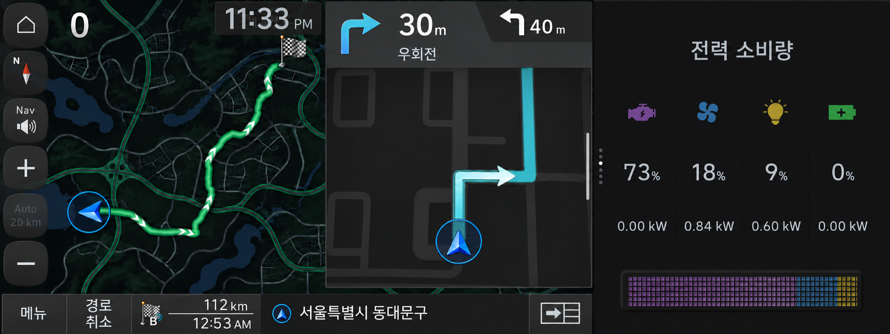

# ccNC Theme for 5W

5W 내비게이션에서 미디어 정보와 오른쪽 위젯을 더 편하게 사용할 수 있도록 만든 테마입니다.

## 포함된 기능

- 지도 하단에 현재 재생 중인 곡명, 아티스트, 앨범아트와 재생 진행선을 표시합니다. 라디오는 방송 이미지 또는 방송사 로고를 사용합니다.
- 미디어 창을 좌우로 밀어 이전·다음 입력을 보내고, 짧게 누르면 현재 미디어 화면을 엽니다. 긴 제목은 천천히 이동하며 표시합니다.
- 미디어 창을 길게 눌러 미디어 옆 버튼과 하단 중앙 스와이프 기능을 각각 설정할 수 있습니다. `None`, `Apps`, `Favorites App`, `Media Control`, `WARMER` 중 선택할 수 있으며, 버튼은 왼쪽 또는 오른쪽에 두거나 숨길 수 있습니다. 앱 목록에는 NEMESIS와 HMG-API 바로가기도 제공합니다.
- 곡 변경 알림은 화면 하단에서 올라와 3.5초 동안 머문 뒤 내려갑니다. 알림을 터치하면 바로 닫힙니다.
- CarPlay 일시정지 시 앨범아트를 어둡게 하고 일시정지 표시를 겹쳐 보여줍니다.
- 볼륨창은 마지막 조작 후 2초 뒤 사라집니다.
- 길안내 중 도착 예상 배터리와 남은 시간을 기존 거리·도착 시간과 번갈아 표시합니다.
- 하단 중앙을 위로 밀어 설정한 기능을 실행할 수 있습니다.
- 오른쪽 패널의 막대를 밀어 창을 열고 닫습니다. 위젯은 위아래로 넘기며, 현재 위치는 점으로 표시합니다.
- **길안내 목록 펼치기·접기:** 기존 우측 하단의 순정 버튼을 대신해 ccNC 스타일의 버튼을 안내 영역에 표시합니다. 목록을 펼쳤을 때는 상단 탭 왼쪽의 접기 버튼으로 목록을 닫고, 접혔을 때는 간단한 길안내 상자의 우측 하단 버튼으로 다시 펼칠 수 있습니다.
- **NAV 버튼 매핑:** ccNC의 Search 버튼처럼 사용할 수 있도록 NAV 버튼을 짧게 한 번 누르면 통합검색을 열고 음성인식을 시작합니다. 길게 누르면 기존의 검색·경로 화면으로 이동합니다. 길게 누르기 동작은 수정 후 차량에서 재검증이 필요합니다.
- 화이트·블랙 테마를 지원하며, 시스템 테마가 확인되지 않으면 블랙 테마를 사용합니다.

## 지원 차량

| 차량 | 연식 | 상태 |
| --- | --- | --- |
| 아이오닉 5 (NE) | 2023–2024 | 검증 완료 |

차종 제한은 두지 않았으므로 다른 차량에서도 설치할 수 있습니다. 다만 검증된 차량 외에는 화면 크기, 순정 앱과 입력 방식이 달라 일부 기능이 동작하지 않을 수 있습니다. 현재 구현은 5W 내비게이션의 특정 화면 크기와 순정 구성에 의존합니다.

## 스크린샷

위치정보 보호를 위해 지도와 일부 표시를 편집한 예시 이미지입니다.

**1. 미디어 창** — 곡 정보와 앨범아트, 재생 진행선을 지도 하단에 표시합니다. CarPlay 음악을 일시정지하면 앨범아트가 어두워지고 가운데 일시정지 표시가 나타납니다. 미디어 정보를 좌우로 밀어 이전 곡이나 다음 곡으로 변경할 수 있습니다.

**2. 길안내 정보** — 길안내 중에는 남은 거리·도착 예정 시간과 도착 예상 배터리·예상 잔여 시간을 10초마다 번갈아 보여줍니다.



**3. 미디어 창 설정** — 미디어 창을 길게 눌러 미디어 옆 버튼과 화면 중앙 하단에서 위로 미는 제스처에 각각 원하는 기능을 설정할 수 있습니다. 버튼은 왼쪽이나 오른쪽에 두거나 없앨 수 있습니다. 예를 들어 하단 스와이프에 `WARMER`를 설정해 창을 열 수 있습니다.



**4. 길안내 목록** — 안내 영역의 ccNC 스타일 버튼으로 목록을 펼치고 접을 수 있습니다.



**5. 볼륨창** — 음량을 조절하면 하단에 ccNC 스타일의 볼륨 정보가 표시되며 화이트·블랙 테마에 대응합니다.



**6. 오른쪽 위젯** — 오른쪽 패널을 열어 위젯을 위아래로 넘기고 현재 위치를 점으로 확인할 수 있습니다. 손잡이는 사용하지 않으면 사라지며, 지도에서 보이지 않을 때도 원래 위치를 끌어오면 동작하고 손잡이가 다시 나타났다가 몇 초 뒤 사라집니다.



## 설치

1. [릴리즈](../../releases)에서 USB 설치용 ZIP을 내려받아 압축을 풉니다.
2. 압축을 푼 `HMGAPI` 폴더를 USB 저장장치의 최상위에 복사합니다. 다른 `HMGAPI` 폴더가 있다면 내용을 합칩니다.
3. 차량의 HMG-API에서 USB 업데이트를 확인하고 `ccNC Theme for 5W`를 설치합니다.
4. 필요하면 내비게이션을 재시작합니다.

HMG-API가 미리 설치되어 있어야 합니다. 미디어 표시나 오른쪽 패널 손잡이 기능을 제공하는 이전 시험 모듈은 비활성화해 주세요.

또한, 설치로 인해 발생되는 모든 문제 및 책임은 사용자에게 있습니다.

## 확인이 필요한 기능

- Media Control의 재생·일시정지는 아직 정상 동작을 확인하지 못했습니다.
- NAV 길게 누르기와 세 번 누르기는 입력 방식 변경 후 재검증이 필요합니다.
- 길안내 버튼의 표시 조건은 순정 경로 이탈 상태를 사용하며, 모든 상황에서 안내 상자 표시 여부와 일치하는지는 추가 검증이 필요합니다.
- 실내 주차장 감지와 P 버튼 이동은 추가 검증이 필요합니다.
- 서라운드뷰를 지도와 함께 표시하는 기능은 연구 중이며 현재 차량 설치 버전에 포함되지 않습니다.

## 빌드

원본 ZIP, 0.1.34 기준 패키지와 서명 키는 저장소에 포함하지 않습니다. 0.1.45 차량 설치본은 서명된 0.1.34 패키지를 기준으로 필요한 미디어 클래스만 교체해 빌드했습니다. 기준 패키지에 포함된 오른쪽 패널 등 기존 클래스는 그대로 사용하므로 저장소의 해당 소스와 차량에서 동작하는 코드가 완전히 일치하지 않을 수 있습니다. 기본 도구 경로는 이 프로젝트 상위 작업공간의 `.tools`와 `simulation_source/build/signclasses`를 사용합니다.

```sh
python3 tools/build.py --release-base "/path/to/ccnc-theme-for-5w-0.1.34.zip" --key /path/to/signing.key
```

빌드 시 기준 패키지의 SHA-256을 확인하고 테스트와 HMG-API 서명을 수행합니다. 기존 설치를 업데이트하려면 기존 HMG-API 서명 키가 필요합니다.

## 기여

버그 수정과 개선을 위한 Pull Request를 환영합니다. 참여 방법은 [기여 안내](CONTRIBUTING.md)를 확인해 주세요.

## 라이선스

Copyright © 2026 blackr. All rights reserved. 사용 조건은 [LICENSE](LICENSE)를 확인해 주세요.
